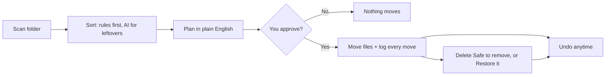

# Laptop Care Agent

An AI helper that tidies your Downloads folder, asks before it changes anything, and can undo everything.

## Main use case

Downloads folders fill up with receipts, school work, screenshots, old installers and duplicate copies. Laptop Care Agent reads each file, proposes a plain-English plan ("Move 8 files into Receipts, set aside 5 duplicates…"), and only acts once you approve. Every move is logged, nothing is deleted unless you say Yes, and one click puts everything back.

It runs fully on your laptop with a small local AI model, so your files never leave your machine. It's built to work on an everyday 8 GB laptop.

## Why I'm building this

[2–3 sentences in your own words: what you noticed, who it's for, why it matters to you.]

## How it works



1. **Scan:** reads every file's name, size, dates and the first 300 characters of PDFs, Word, text and CSV files. Finds exact duplicates by their contents (sha256).
2. **Sort:** rules handle the obvious files (extensions, "Screenshot" names, keywords like invoice or lecture). You pick the local model on the start page (`llama3.2:1b`, `llama3.2:3b`, or `qwen2.5:3b`). It only sees files the rules can't place, and can only choose Receipts, School, Work, Other or Review. HTML, CSS, and code skip the model on a normal scan. The prompt lives in `prompts/sort_prompt.txt`.
3. **Plan:** shows where every file will go and why ("rule: text contains invoice" or "ai: gym payment").
4. **Approve:** nothing moves until you click Approve in the app (or type `yes` on the command line).
5. **Act:** files go into category folders; duplicates go to `_safe_to_remove`. Every move is written to the undo log.
6. **Delete (optional):** on the done screen, Delete files removes the whole `_safe_to_remove` folder after a Yes/No popup. A copy waits in `C:\LaptopCareTest\undo_deleted`, so **Restore deleted files back?** can bring it back.
7. **Undo:** a Yes/No popup, then the folder goes back to how it was before Approve, deleted files included. It removes the empty folders it created, the copies, and that run's undo notes.
8. **Ask an agent (optional):** a toggle on the start page. The scan itself does not change. After you ask, **Group by file type** sorts by extension with no model. Any other question uses `qwen2.5:3b`. Rules still place screenshots, installers, photos, archives, and keyword matches. Qwen invents folder names for the rest and reads the start, middle, and end of each file. Unsure files go to Other. Review is only when the name is generic and there is almost no text. Nothing moves until Approve.
9. **Eval (read-only):** the app sidebar switches Tidy | Eval. Eval grades the sorter against `labels.csv`, never moves files, and saves a report under `evals/`. Prompt is **With reason** (the model explains each choice), **Without reason** (the folder only), or **Both**.

## Promises

- Nothing changes without your OK
- Extras go to `_safe_to_remove`. They are only deleted when you say Yes, and Restore or Undo can still bring them back
- Files are never overwritten: name clashes get " (2)"
- One click (or one command) puts every file back, and nothing is left behind
- Files you placed yourself are never moved without asking
- Runs locally: no cloud, no API keys
- Eval never writes inside the folder being graded

## Setup (Windows)

1. Install [Python 3.15](https://www.python.org/downloads/) (tick "Add Python to PATH"), [Git](https://git-scm.com/) and [Ollama](https://ollama.com/).
2. Download the AI models you want to compare:
   ```powershell
   ollama pull llama3.2:1b
   ollama pull llama3.2:3b
   ollama pull qwen2.5:3b
   ollama run llama3.2:1b "say hi"     # first reply is slow while the model loads
   ```
3. Get the code and install:
   ```powershell
   git clone https://github.com/<your-username>/laptop-care-agent.git
   cd laptop-care-agent
   py -3.15 -m venv .venv
   .venv\Scripts\activate
   pip install -r requirements.txt
   ```

## Quick start

```powershell
python make_test_folder.py --count 50   # build a fake messy folder at C:\LaptopCareTest\Downloads
python scanner.py                       # count files and duplicates (read-only)
python planner.py                       # see the plan (nothing moves)
python executor.py --apply              # type "yes" to tidy up
python executor.py --undo               # put everything back
streamlit run app.py                    # Tidy + Eval at http://localhost:8501
python evals/run_eval.py --seed 42      # grade against labels.csv (read-only)
```

The agent only ever touches the test folder set in `config.py`. Its undo log (`undo.log`) and the copies of deleted files (`undo_deleted`) sit beside it in `C:\LaptopCareTest`, and both are removed once nothing is left to undo.

## All commands

| Command | What it does |
|---|---|
| `python make_test_folder.py --count 50` | Build a messy test folder and `labels.csv` (refuses if the folder isn't empty) |
| `python make_test_folder.py --count 120 --seed 42` | Bigger, repeatable folder for evals and the demo |
| `python make_test_folder.py --count 120 --hard 30 --seed 42` | Same, plus 30 extra hard files (clear/edge) for a tougher AI eval |
| `python add_label.py <file name> <category>` | Label a file you added to the test folder by hand |
| `python add_label.py <file> <category> --folder PATH` | Label a file in another allowed folder (for a real-file eval set) |
| `python scanner.py` | File count, total size, duplicates found; warns about unlabeled files |
| `python planner.py` | Plain-English plan using rules + AI |
| `python planner.py --no-ai` | Plan using rules only |
| `python planner.py --model llama3.2:3b` | Ask a specific Ollama model |
| `python planner.py --no-reason` | Ask for a category only (no short reason) |
| `python planner.py --debug` | Also print the exact prompt and raw AI answer for each AI file |
| `python executor.py --apply` | Show the plan, type `yes` to apply, then answer yes/no for suggested fixes |
| `python executor.py --undo` | Undo the most recent run, and put deleted files back |
| `python executor.py --runs` | List past runs |
| `python evals/run_eval.py` | Grade Rules only + downloaded models against `labels.csv` |
| `python evals/run_eval.py --both-prompts --seed 42` | Compare with-reason vs without-reason |
| `python evals/run_eval.py --setups rules llama3.2:1b` | Run only the setups you name |
| `python -m pytest -v` | Run the tests (undo, eval scoring, hard-file checks, ask-agent) |
| `streamlit run app.py` | App: sidebar **Tidy** (organize) or **Eval** (grade) |

**Reset the test folder** (deletes only the test files; check the path first):
```powershell
Remove-Item -Recurse -Force C:\LaptopCareTest\Downloads\*
Remove-Item C:\LaptopCareTest\labels.csv
Remove-Item -Recurse -Force C:\LaptopCareTest\undo.log, C:\LaptopCareTest\undo_deleted -ErrorAction SilentlyContinue
python make_test_folder.py --count 120 --hard 30 --seed 42
```

## Duplicates: which copy is kept

Duplicates are files with identical contents, whatever their names. In each group:
1. Copy-style names ("(1)", "(2)", " - Copy") always lose.
2. Among the rest, the file that arrived first (earliest created date) is kept.
3. Ties go to the older modified date, then alphabetical order.

## Project structure

```
config.py            test folder path, categories, MODELS / DEFAULT_MODEL
make_test_folder.py  builds the fake messy folder + labels.csv (--hard 5 or 30)
add_label.py         labels a hand-added test file
scanner.py           reads files, finds duplicates (never changes anything)
classifier.py        rules first, then the local AI with guardrails
prompts/sort_prompt.txt   sorting prompt the model sees
planner.py           builds the plan and its plain-English summary
executor.py          applies an approved plan, logs moves, deletes with a kept copy, undoes runs
app.py               Streamlit: Tidy mode
eval_view.py         Streamlit: Eval mode screen
evaluate.py          read-only grading (no Streamlit)
evals/run_eval.py    command-line eval
evals/results_*.csv  per-run grade sheets (local time in the name)
ask_agent.py         Ask an agent: Qwen reads the files, or group by extension
ideas.md             ideas not built yet, including how to make Ask faster
verify.py            folder snapshots used by the tests and by eval
tests/               undo, eval, hard-file, and ask-agent tests
DECISIONS.md         why it works this way
FIXES.md             bugs found while building the app, and what changed
```

## Built with

Python 3.15 · Ollama (llama3.2:1b / 3b, qwen2.5:3b on an 8 GB laptop) · pypdf · python-docx · pytest · Streamlit

## Status

- [x] Test folder generator (including `--hard 30`)
- [x] Scan and duplicate detection (txt, csv, pdf, docx previews)
- [x] Sort and plan (rules + local AI, prompt file, optional reason)
- [x] Approve, apply, undo
- [x] Clickable app and report card
- [x] Delete and restore on the done screen
- [x] Ask an agent (scan unchanged; Qwen names folders for leftovers; group-by-type is the one rule)
- [x] Model picker for a normal scan
- [x] Eval mode (app + CLI): models, wrong moves, category/difficulty splits
- [ ] Simple mode for older users
- [ ] Real-file eval set (~20 labeled files)

## Results so far

Early check on 52 unique files (before the harder set):

| Setup | Correct | Review | Wrong moves |
|---|---|---|---|
| Rules only | 44 | 8 | 0 |
| Rules + llama3.2:1b | 49 | 1 | 2 |

Latest generated-folder eval (`--count 120 --hard 30`, 147 files graded, duplicates excluded). Full tables live in `evals/results_*.md`.

| Setup | Prompt | Correct | Review | Wrong moves | Accuracy % |
|---|---|---|---|---|---|
| Rules only | none | 105 | 42 | 0 | 71.4 |
| llama3.2:1b | with reason | 127 | 2 | 18 | 86.4 |
| llama3.2:3b | with reason | 141 | 0 | 6 | 95.9 |
| qwen2.5:3b | without reason | 143 | 1 | 3 | 97.3 |

Duplicates on that run: 11 found, 0 missed, 0 wrongly flagged. Folder unchanged. See `DECISIONS.md` for how each choice was made.
