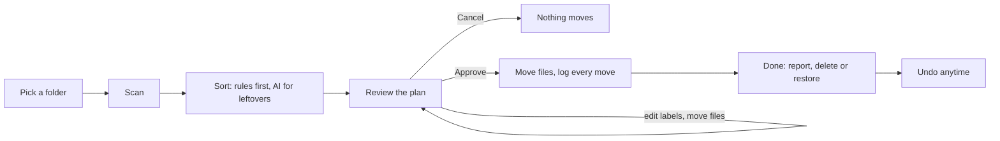

# Laptop Care Agent

A small AI helper that tidies a messy folder. It suggests a plan, waits for your approval, and can undo everything. It runs fully on your laptop.

> **[Demo video: add link]** · **[Screenshot: add image]**

## Why I built this

My own Downloads folder had grown to 48 GB: 76,507 files across 5,671 folders. Resumes, cover letters, screenshots, CSVs and old installers, all mixed together. Sorting it meant opening file after file, and I didn't trust a tool to move things without showing me first.

So I built something to do the boring part (reading each file and suggesting where it belongs) without the risk. It shows its plan, waits for my yes, and can undo everything.

It's still a work in progress: a prototype that only makes changes in a test folder for now.

## How it works



1. **Pick a folder.** System folders (like `C:\Windows`) are blocked. *Approve only moves files in the test folder*; any other folder is preview-only for now.
2. **Scan.** Reads each file's name, size, dates and the start of its text (PDF, Word, text, CSV). Finds exact duplicates by their contents, not their names.
3. **Sort.** Rules handle the obvious files (extensions, "Screenshot" names, keywords like *invoice* or *lecture*). A local AI model only sees the leftovers and can only choose Receipts, School, Work, Other or Review.
4. **Review.** Every file is shown on a label card with the reason it's going there. AI decisions are marked. You can rename, add or remove labels, move files between labels, preview a file, or open it on your PC. Duplicates and large files (over 100 MB) have their own cards.
5. **Approve.** Nothing moves until you click Approve.
6. **Done.** Shows what moved, plus disk and battery health. Duplicates sit in `_safe_to_remove`. *Delete files* removes them after a Yes/No, but keeps a copy so *Restore* can bring them back.
7. **Undo.** Puts every file back, including deleted ones, and removes the empty folders it created.

**Two extra modes:**
- **Ask an agent** (a toggle on the start page): after the scan, type a request such as "Sort by what's inside" and `qwen2.5:3b` suggests new folder names for the leftovers. "Group by file type" sorts by extension without AI. Nothing moves until Approve.
- **Eval** (in the sidebar): grades the sorter against an answer key, compares models, and never changes the folder.

## Safety promises

- Nothing moves without your approval.
- Files are never overwritten; a name clash gets " (2)".
- Duplicates are set aside, not deleted. Deleting needs a Yes, and Restore or Undo can still bring files back.
- Files you placed yourself are never moved without asking.
- Folders you made yourself are read, but their files stay put, unless one is an exact duplicate (set aside only after Approve).
- Everything runs locally: no cloud, no API keys. The app only listens on `localhost`.

## Results

Graded on a generated test folder (158 files: 147 sorted, 11 duplicates). Full tables are in [`evals/`](evals/).

| Setup | Correct | Review | Wrong moves | Accuracy | Time per AI file |
|---|---|---|---|---|---|
| Rules only | 105 | 42 | 0 | 71.4% | — |
| llama3.2:1b (with reason) | 127 | 2 | 18 | 86.4% | 1.1 s |
| llama3.2:3b (with reason) | 141 | 0 | 6 | 95.9% | 2.6 s |
| qwen2.5:3b (with reason) | 142 | 0 | 5 | 96.6% | 2.4 s |
| **qwen2.5:3b (without reason)** | **143** | **1** | **3** | **97.3%** | **2.0 s** |

- **Duplicates:** 11 found, 0 missed, 0 wrongly flagged.
- **Rules are safe but limited:** 0 wrong moves, but 42 files left for the user.
- **The 1B model helps, but makes 18 wrong moves.** The 3B models cut that to 3–6 at about twice the time.
- **Asking for a short reason** helped llama, but not qwen.
- **The folder was unchanged** after every eval run.
- **Honest limit:** the test files and the rules come from the same project, so real folders will be harder. *Real-file results: [add after testing ~20 of your own files].*
- A **wrong move** (a file filed in the wrong folder) is counted separately from Review, because it's worse: the user may not find the file.

## Setup (Windows)

1. Install [Python 3.15](https://www.python.org/downloads/) (tick "Add Python to PATH"), [Git](https://git-scm.com/) and [Ollama](https://ollama.com/).
2. Download the models:
   ```powershell
   ollama pull llama3.2:1b
   ollama pull llama3.2:3b
   ollama pull qwen2.5:3b
   ```
3. Install the project:
   ```powershell
   git clone https://github.com/shifamehreen-005/laptop-care-agent.git
   cd laptop-care-agent
   py -3.15 -m venv .venv
   .venv\Scripts\activate
   pip install -r requirements.txt
   ```

Tested on an 8 GB laptop with a GTX 1650. Only one model is loaded at a time.

## Quick start

```powershell
python make_test_folder.py --count 120 --hard 30 --seed 42   # fake messy folder at C:\LaptopCareTest\Downloads
streamlit run app.py                                          # open http://localhost:8501
```

In the app: **Browse** to the test folder, **Scan**, review the plan, **Approve**, then try **Undo**.

## Commands

| Command | What it does |
|---|---|
| `python make_test_folder.py --count 50` | Small test folder plus `labels.csv` (the answer key) |
| `python make_test_folder.py --count 120 --hard 30 --seed 42` | The eval folder, with 30 extra hard files |
| `python add_label.py <file> <category> [--folder PATH]` | Label a file you added by hand |
| `python scanner.py` | Count files and duplicates (read-only) |
| `python planner.py [--no-ai] [--model NAME] [--debug]` | Print the plan without moving anything |
| `python executor.py --apply` / `--undo` / `--runs` | Apply a plan (type `yes`), undo the last run, or list runs |
| `python evals/run_eval.py --both-prompts` | Grade every setup against `labels.csv` |
| `python -m pytest -v` | Run the tests |
| `streamlit run app.py` | The app: **Tidy** or **Eval** in the sidebar |

**Reset the test folder** (deletes only the test files; check the path first):
```powershell
Remove-Item -Recurse -Force C:\LaptopCareTest\Downloads\*
Remove-Item C:\LaptopCareTest\labels.csv
Remove-Item -Recurse -Force C:\LaptopCareTest\undo.log, C:\LaptopCareTest\undo_deleted -ErrorAction SilentlyContinue
```

## Which duplicate is kept

Duplicates have identical contents, whatever their names. In each group:
1. Copy-style names ("(1)", " - Copy") always lose.
2. Otherwise, the file that arrived first (earliest created date) is kept.
3. Ties go to the older modified date, then alphabetical order.

## Project files

| File | Job |
|---|---|
| `config.py` | Test folder, categories, models |
| `make_test_folder.py` | Builds the fake folder and `labels.csv` |
| `scanner.py` | Reads files and finds duplicates (never changes anything) |
| `classifier.py` + `prompts/sort_prompt.txt` | Rules, then the AI with guardrails |
| `planner.py` | Builds the plan and its plain-English summary |
| `executor.py` | Applies an approved plan, deletes with a kept copy, undoes |
| `app.py` | The Streamlit app (Tidy mode) |
| `ask_agent.py` | Ask an agent |
| `evaluate.py`, `eval_view.py`, `evals/run_eval.py` | Eval (read-only) |
| `safety.py` | Blocks system folders |
| `folders.py` | Saved labels |
| `health.py` | Disk and battery health |
| `verify.py` | Folder snapshots for tests and eval |
| `tests/` | Undo, eval, hard-file and Ask tests |
| [`DECISIONS.md`](DECISIONS.md) | Why it works this way |
| [`FIXES.md`](FIXES.md) | Bugs found and how they were fixed |
| [`ideas.md`](ideas.md) | Future work |

## Status

- [x] Scan, duplicates, sort (rules plus local AI), plan
- [x] Review screen: labels, moves, previews, large files
- [x] Approve, delete with restore, undo
- [x] Ask an agent
- [x] Eval mode with model comparison
- [ ] Approve on real folders (currently preview-only)
- [ ] Real-file eval (about 20 of my own files)
- [ ] Simple mode for older users

## Built with

Python · Streamlit · Ollama (llama3.2:1b and 3b, qwen2.5:3b) · pypdf · python-docx · pytest

Built with help from AI coding tools. Every design choice is written down in `DECISIONS.md`.