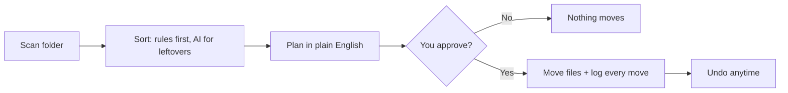

# Laptop Care Agent

An AI helper that tidies your Downloads folder, asks before it changes anything, and can undo everything.

## Main use case

Downloads folders fill up with receipts, school work, screenshots, old installers and duplicate copies. Laptop Care Agent reads each file, proposes a plain-English plan ("Move 8 files into Receipts, set aside 5 duplicates…"), and only acts once you approve. Every move is logged, nothing is ever deleted, and one command puts everything back.

It runs fully on your laptop with a small local AI model, so your files never leave your machine. It's built to work on an everyday 8 GB laptop.

## Why I'm building this

[2–3 sentences in your own words: what you noticed, who it's for, why it matters to you.]

## How it works



1. **Scan:** reads every file's name, size, dates and the first 300 characters of PDFs, Word and text files. Finds exact duplicates by their contents (sha256).
2. **Sort:** rules handle the obvious files (extensions, "Screenshot" names, keywords like invoice or lecture). The local AI (`llama3.2:1b`) only sees files that rules can't place, and can only choose Receipts, School, Work, Other or Review.
3. **Plan:** shows where every file will go and why ("rule: text contains invoice" or "ai: model said School").
4. **Approve:** nothing moves until you type `yes`.
5. **Act:** files go into category folders; duplicates go to `_safe_to_remove`. Every move is written to the undo log.
6. **Undo:** reverses the last run and removes only the empty folders it created.

## Promises

- Nothing changes without your OK
- Nothing is deleted: extras go to `_safe_to_remove`
- Files are never overwritten: name clashes get " (2)"
- One command puts every file back
- Files you placed yourself are never moved without asking
- Runs locally: no cloud, no API keys

## Setup (Windows)

1. Install [Python 3.15](https://www.python.org/downloads/) (tick "Add Python to PATH"), [Git](https://git-scm.com/) and [Ollama](https://ollama.com/).
2. Download the AI model:
   ```powershell
   ollama pull llama3.2:1b
   ollama run llama3.2:1b "say hi"     # first reply is slow while the model loads
   ```
3. Get the code and install:
   ```powershell
   git clone https://github.com/<your-username>/laptop-care-agent.git
   cd laptop-care-agent
   py -3.15 -m venv .venv
   .venv\Scripts\activate
   pip install -r requirements.txt
   ```

## Quick start

```powershell
python make_test_folder.py --count 50   # build a fake messy folder at C:\LaptopCareTest\Downloads
python scanner.py                       # count files and duplicates (read-only)
python planner.py                       # see the plan (nothing moves)
python executor.py --apply              # type "yes" to tidy up
python executor.py --undo               # put everything back
```

The agent only ever touches the test folder set in `config.py`.

## All commands

| Command | What it does |
|---|---|
| `python make_test_folder.py --count 50` | Build a messy test folder and `labels.csv` (refuses if the folder isn't empty) |
| `python make_test_folder.py --count 120 --seed 42` | Bigger, repeatable folder for evals and the demo |
| `python add_label.py <file name> <category>` | Label a file you added to the test folder by hand |
| `python scanner.py` | File count, total size, duplicates found; warns about unlabeled files |
| `python scanner.py --show-duplicates` | Each kept file with the copies set aside under it |
| `python planner.py` | Plain-English plan using rules + AI |
| `python planner.py --no-ai` | Plan using rules only |
| `python planner.py --debug` | Also print the exact prompt and raw AI answer for each AI file |
| `python executor.py --apply` | Show the plan, type `yes` to apply, then answer yes/no for suggested fixes |
| `python executor.py --undo` | Undo the most recent run |
| `python executor.py --runs` | List past runs |
| `python -m pytest -v` | Run the tests (apply → undo leaves the folder exactly as it was) |

**Reset the test folder** (deletes only the test files; check the path first):
```powershell
Remove-Item -Recurse -Force C:\LaptopCareTest\Downloads\*
Remove-Item C:\LaptopCareTest\labels.csv
python make_test_folder.py --count 50
```

## Duplicates: which copy is kept

Duplicates are files with identical contents, whatever their names. In each group:
1. Copy-style names ("(1)", "(2)", " - Copy") always lose.
2. Among the rest, the file that arrived first (earliest created date) is kept.
3. Ties go to the older modified date, then alphabetical order.

## Project structure

```
config.py            test folder path and categories
make_test_folder.py  builds the fake messy folder + labels.csv
add_label.py         labels a hand-added test file
scanner.py           reads files, finds duplicates (never changes anything)
classifier.py        rules first, then the local AI with guardrails
planner.py           builds the plan and its plain-English summary
executor.py          applies an approved plan, logs moves, undoes runs
verify.py            folder snapshots used by the tests
tests/               apply → undo tests
DECISIONS.md         why it works this way
```

## Built with

Python 3.15 · Ollama (llama3.2:1b, on a GTX 1650 laptop with 8 GB of RAM) · pypdf · python-docx · pytest · Streamlit (coming)

## Status

- [x] Test folder generator
- [x] Scan and duplicate detection
- [x] Sort and plan (rules + local AI)
- [x] Approve, apply, undo
- [ ] Clickable app and report card
- [ ] Simple mode for older users
- [ ] Evals and demo

## Results so far

On 52 unique test files:

| Setup | Correct | Sent to Review | Wrong moves |
|---|---|---|---|
| Rules only | 44 | 8 | 0 |
| Rules + llama3.2:1b | 49 | 1 | 2 |

Full evals, including real files, are coming. See `DECISIONS.md` for how each choice was made.