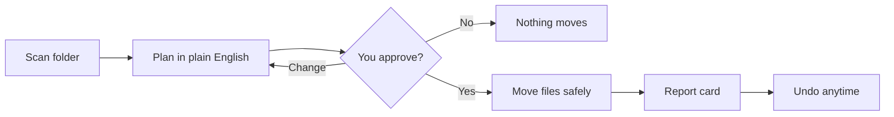

# Laptop Care Agent

An AI helper that tidies your laptop and asks before it changes anything.

## Why I'm building this
[2–3 sentences in your own words: what you noticed, who it's for, why it matters to you.]

## How it works

## Promises
- Nothing changes without your OK
- Nothing is deleted: extras go to a "Set aside" folder for 30 days
- One click puts every file back
- Runs locally: your files never leave your laptop

## Built with
Python · Streamlit · Ollama (llama3.2:1b, on a GTX 1650 laptop with 8 GB of RAM)

## Status
- [ ] Scan and plan
- [ ] Approve, act, undo
- [ ] App and report card
- [ ] Simple mode
- [ ] Evals and demo

## Results
Coming soon.